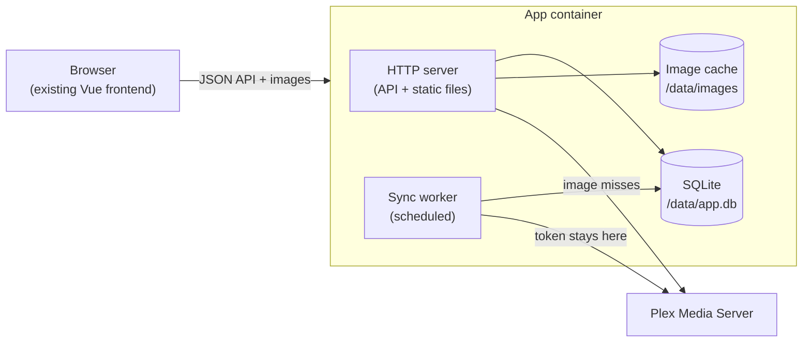

# Proposal: A Server-Backed Cast & Crew App

**Status:** Accepted
**Date:** 2026-10-27

**Decisions:**
- Backend language: TypeScript on Node.js.
- The Media Quality page is not carried over; the app is Cast & Crew only.
- The project is named **MediaData** and stays in the existing repository, keeping its git history.

## Summary

Split the Cast & Crew page out of the Medialytics fork into its own application with a small backend. The backend syncs your Plex libraries into a local SQLite database on a schedule, serves that data to the browser through a simple JSON API, and proxies and caches artwork. The frontend keeps its current look and its client-side filtering, but reads from the backend instead of calling Plex directly.

The recommended stack is **one Docker container: a TypeScript/Node backend (Fastify) with SQLite and an on-disk image cache.** It serves both the API and the existing static frontend.

## Why change

| Today | Problem | With a backend |
|---|---|---|
| Every page load fetches the whole library from Plex, then about 1 request per 50 titles for full credits | Slow on large libraries; repeats the same work on every visit and every device | Data is synced once in the background and served from SQLite in one request |
| The Plex token is substituted into `js/*.js` at container start | **Anyone who can load the page can read your Plex admin token** from the downloaded JavaScript | The token lives only in the backend's environment and never reaches the browser |
| No server-side state | No artwork cache, no history, nothing persisted besides `localStorage` | Room for images, saved filters, watch history, etc. |
| Built around Medialytics' single huge `scripts.js` | New features have to fit the Medialytics design | An app shaped around cast and crew |

## Architecture



Components, all in one process:

1. **Sync worker**: pulls from Plex and writes normalized rows to SQLite.
2. **API**: read-only JSON over that data, plus endpoints to trigger and monitor a sync.
3. **Image proxy**: resizes artwork through Plex, caches it on disk, and serves it with long-lived cache headers.
4. **Static frontend**: today's `index.html`, `cast-crew.js` and CSS, served by the same server.

A single container keeps deployment the same as today: one image, one `docker compose` entry and one volume.

## Technology choice

**Recommended: Node.js 22 + TypeScript, Fastify, `better-sqlite3`, `sharp` (optional).**

- One language across frontend and backend, so the item and credit types can be shared and some of today's client-side counting can move to the server later without a rewrite.
- `better-sqlite3` is synchronous and fast, which suits a single-writer sync job well.
- Fastify gives JSON schema validation and gzip with very little setup.

**Reasonable alternative: Python 3.12 + FastAPI + SQLite (SQLModel or plain `sqlite3`).** Choose this if you'd rather write the backend in Python, for example for data-analysis features. The design below doesn't depend on the language.

**Database: SQLite**, as a file on a Docker volume. It's one user, a few thousand to tens of thousands of titles, and one writer. Postgres would add a second container and buy nothing at this scale. The schema avoids SQLite-only features, so moving later would be straightforward.

## Data model

```
libraries      (id, plex_key, title, type, last_synced_at)
items          (id, library_id, plex_rating_key, title, title_sort, year,
                audience_rating, critic_rating, content_rating, duration_min,
                studio, added_at, updated_at, last_viewed_at, view_count,
                thumb_path, art_path, summary)
item_guids     (item_id, provider, external_id)        -- imdb/tmdb/tvdb
people         (id, name, plex_tag_id, plex_tag_key, thumb_url)
credits        (item_id, person_id, kind, billing_order, character)
                                                        -- kind: actor|director|writer
tags           (id, kind, name)                         -- genre|country|collection
item_tags      (item_id, tag_id)
sync_runs      (id, library_id, started_at, finished_at, status,
                items_seen, items_updated, error)
```

Notes:

- `credits.billing_order` replaces today's "top N billed" slicing, so the depth setting becomes `WHERE billing_order < N` or a client-side filter.
- People are matched across titles by Plex's global `tagKey` when present, falling back to name. This also prepares for exact IMDb/TMDB person links later.
- Watched state (`last_viewed_at`, `view_count`) lives on `items` and is refreshed frequently and cheaply (see below).

## Sync strategy

Plex data changes in two ways: rarely (new titles, metadata edits) and often (watched state). The sync treats them differently.

**Light sync (every 15 minutes by default, configurable):**
1. `GET /library/sections` updates the library list.
2. For each library, one `GET /library/sections/{id}/all?includeGuids=1` call. That's one request per library, and it's what the page does today on every load.
3. Upsert scalar fields (ratings, watched state, `updated_at`) for every item.
4. Collect the items whose Plex `updatedAt` is newer than stored, or that are new. Delete items that are no longer present.

**Credit fetch (only for new or changed items):**
5. `GET /library/metadata/{k1,k2,...}?includeGuids=1` in batches of 50, with 3 in flight. This is today's client-side logic moved to the server.
6. Replace those items' credits, tags and GUIDs in one transaction per batch.

Consequences:
- The **first** sync of a large library takes as long as today's full-credit load, but it runs once in the background with progress visible in the UI.
- After that, a typical sync is one request per library plus a handful of metadata batches.
- **Triggers:** on startup, on the interval, and from a "Refresh now" button (`POST /api/sync`). Plex webhooks (which need Plex Pass) could trigger a sync on "library.new" later. They're not needed for the first version.

## API

All JSON, all read-only except sync. Responses are gzip-compressed.

| Method | Path | Purpose |
|---|---|---|
| GET | `/api/libraries` | Libraries with item counts and last sync time |
| GET | `/api/libraries/:id/items` | Every item in a library, in the shape the frontend's `castItems` uses today |
| GET | `/api/libraries/:id/collections` | Collections with item counts |
| GET | `/api/items/:id` | One item in full (summary, full credits with characters, GUIDs) |
| GET | `/api/people/:id` | A person and their credits across libraries |
| POST | `/api/sync` | Start a sync (optionally `?library=:id`) |
| GET | `/api/sync/status` | Current or last sync progress |
| GET | `/api/images/:kind/:id?w=300` | Cached artwork: item poster or backdrop, person headshot |
| GET | `/api/health` | Liveness for Docker |

**Payload size for `/items`:** with full casts, repeating every actor's name per title gets large (5,000 titles × 40 names). The response sends people once, and items refer to them by ID:

```json
{
  "people": { "17": "Morgan Freeman", "42": "Tim Robbins" },
  "items": [
    { "id": 1, "title": "The Shawshank Redemption", "year": 1994,
      "rating": 9.3, "criticRating": 9.1, "length": 142, "watched": true,
      "imdbId": "tt0111161", "studio": "Castle Rock",
      "genres": ["Drama"], "countries": ["United States of America"],
      "actors": [42, 17], "directors": [88], "writers": [88, 91] }
  ]
}
```

The client rebuilds name arrays once on load. Filtering, ranking and charts stay client-side. They're already fast (about 30–80 ms on a 5,000-title test library), and keeping them there avoids reworking the frontend now. Moving aggregation server-side can come later if libraries outgrow it.

## Images

- Plex resizes images itself: `/photo/:/transcode?width=W&height=H&url=<thumb path>`. The backend calls this, stores the result under `/data/images/<kind>/<id>-<width>.jpg`, and serves it with `Cache-Control: public, max-age=31536000, immutable`. The URL includes a version derived from Plex's `updated_at`, so changed artwork gets a new URL.
- Actor headshots in Plex are usually absolute URLs to Plex's metadata CDN or TMDB. The proxy fetches and caches those the same way, so the browser never talks to Plex or third parties directly.
- Images are fetched lazily on first request, and a small fixed set of widths (e.g. 150, 300, 600) bounds disk use. An optional pre-warm step can fetch posters after a sync.

## Frontend changes

The UI stays largely as it is. The changes are mechanical:

1. Replace the four direct Plex calls (library list, `/all`, `/collections`, batched `/library/metadata`) with `/api/libraries` and `/api/libraries/:id/items`.
2. **Delete** the client-side full-credit loading and its progress bar. That data arrives complete from the API, and a small "Last synced 5 min ago · Refresh" line replaces it.
3. Build `castItems` straight from the API response instead of from Plex's shape. The filters, tables, charts and type-aheads keep working on the same normalized items.
4. Remove `SERVER_IP` / `SERVER_TOKEN` substitution from the frontend entirely.

The Cast & Crew page currently leans on Medialytics' `scripts.js` (about 3,700 lines) for library loading, category charts and the table component. For the new app, the plan is to **extract only the pieces this page uses** (the chart-mode toggle, category table, bar/pie rendering and decade drilldown) into the new codebase, and leave the rest behind.

## Configuration and deployment

```yaml
services:
  castcrew:
    image: castcrew:latest
    environment:
      - PLEX_URL=${PLEX_URL}          # e.g. http://192.168.7.10:32400
      - PLEX_TOKEN=${PLEX_TOKEN}      # server-side only
      - SYNC_INTERVAL_MINUTES=15
    volumes:
      - ./data:/data                  # app.db + images/
    ports:
      - "8088:3000"
    restart: unless-stopped
```

- **Backups** are simply copying `./data/app.db`. Everything else can be re-synced from Plex.
- **Access:** the app has no login. It's meant for your LAN, like Medialytics, but the Plex token is no longer exposed to whoever loads the page. If it's ever reachable from outside, put it behind your reverse proxy's auth.
- **Schema migrations:** numbered SQL files applied at startup, tracked in a `schema_version` table.

## Phased plan

| Phase | Scope | Result |
|---|---|---|
| **1. New repo + backend skeleton** | Repo, Docker image, Fastify server serving the current static files, SQLite + migrations, `/api/health` | Same app, now served by the backend |
| **2. Sync + items API** | Library list and `/all` sync, batched credit fetch, `/api/libraries`, `/api/libraries/:id/items`, `/api/sync`, status | Data comes from SQLite; full credits load instantly |
| **3. Frontend switch** | Point the page at the API, remove direct Plex calls and token substitution, extract the needed pieces of `scripts.js` | Token off the client; Medialytics dependency gone |
| **4. Images** | Image proxy + cache, posters in the results table, headshots in the actor table | First feature that needed a server |
| **Later** | Webhook-triggered sync, person pages, exact IMDb/TMDB person links, saved filter presets, watch history over time | |

Phases 1–3 make the app behave as it does today with the server underneath. Each phase is a working, deployable state.

## Risks and mitigations

- **Plex's API is undocumented and can change.** All Plex access goes through one small client module with typed responses, so a change is fixed in one place. The fields the sync relies on (`/all`, `/library/metadata`, `includeGuids`, `updatedAt`) are long-standing and used by other well-known tools.
- **The first sync of a big library is slow.** It runs in the background with progress shown, and the light sync afterwards is cheap.
- **Watched state can lag** by up to the sync interval. The Refresh button covers the cases where that matters, and webhooks can remove the lag later.
- **Vue 2 has been end-of-life since December 2023.** The frontend can stay on it for this move, since nothing here requires an upgrade. Moving to Vue 3 with a build step is a separate, later decision.

## Open questions

1. **Language:** TypeScript/Node (recommended) or Python/FastAPI?
2. **Scope:** should the new app include the original Media Quality page, or only Cast & Crew?
3. **Name and repo:** what should the new project be called, and should it stay connected to the Medialytics fork's git history or start fresh?
4. **Sync interval:** is 15 minutes a sensible default for watched state, or do you want it closer to real time (which points toward webhooks sooner)?
5. **Images:** which ones matter first: posters in the results table, actor headshots, or backdrops?
